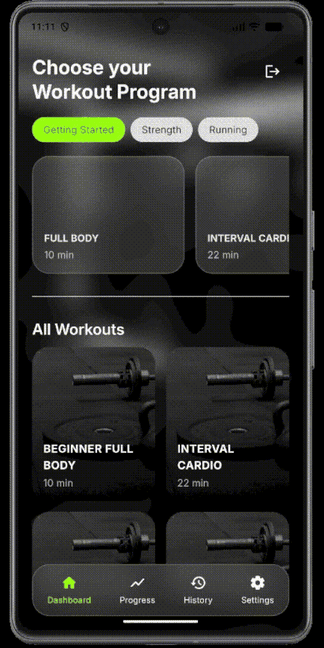
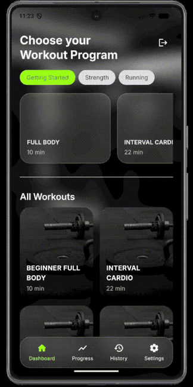

# Viva Fit

A mobile fitness app built with Flutter and Firebase. This was my final-year project.

  
  
  

## Features

- 4 guided workouts (full body, interval cardio, upper body, lower body)
- Manual run and walk timers
- Progress tracker with streaks, weekly stats and badges
- Firebase sign-in with enforced email verification
- Workout history stored per user in Cloud Firestore and synced live
- Accessibility settings: colour-blind modes, dyslexia-friendly font (OpenDyslexic), five text sizes and accent colours

## Built with

Flutter, Dart, Firebase Authentication, Cloud Firestore

## Testing

Run on an Android emulator and as a Windows desktop app. Usability tested with 3 users.

## Running it yourself

The Firebase configuration files are not included in this repository. To run the app you need your own Firebase project:

1. Create a Firebase project with Email/Password sign-in and Cloud Firestore enabled
2. Run `flutterfire configure` in the project folder
3. Run `flutter pub get`, then `flutter run`

Workouts are stored at `users/{uid}/workouts`, and the Firestore rules only let a signed-in user read and write their own data.